# dmarc-report

DMARC aggregate reports arrive as unreadable XML attachments. dmarc-report reads a folder of them, groups messages by sending IP, and answers the real questions: which sources fail both SPF and DKIM alignment and are still being delivered (spoofing or a forgotten sender), which legitimate senders pass on only one mechanism and will break on forwarding, and whether the policy is ready to move from monitoring to enforcement.



**Live demo:** https://jvch0512.github.io/dmarc-report/ (Synthetic reports for example.test from invented receivers, using documentation IP ranges.)

Racket 8 (standard distribution only). The demo page is rendered from the tool's `--tsv` output by `scripts/site.py` (Python 3, only needed to regenerate the page).

## Use

```bash
make test
./bin/dmarc-report examples/reports
./bin/dmarc-report report.xml --tsv
./bin/dmarc-report ./reports --fail-on high      # exit 1 in CI
```

Pass an XML report or a directory of `.xml` files. Gzipped reports must be unpacked first (`gunzip *.gz`).

| Rule | Severity | What it reports |
|---|---|---|
| DMARC101 | high | a source IP with messages that failed both SPF and DKIM alignment and were delivered |
| DMARC102 | medium | a source IP that only passes through one mechanism (SPF only or DKIM only), fragile when mail is forwarded |
| DMARC103 | medium | policy is `p=none` while failing mail is being delivered |
| DMARC104 | low | enforcement applies to only part of the mail (`pct` below 100) |
| DMARC105 | info | overall DMARC pass rate per domain |

See [examples](examples) and [docs/sample-output.txt](docs/sample-output.txt).

## Limits

- Reports are produced by receivers and show only mail that reached them. Small receivers and silent drops are invisible.
- Source IPs are not resolved to owners. You decide which unknown source is a forgotten sender and which is an attacker.
- XML is parsed with Racket's reader, which does not fetch external entities. Reports that are not well formed are skipped with a warning.
- Only the aggregate (rua) format is read. Forensic (ruf) reports are not.

## Where it fits

Email authentication reviews and DMARC rollouts: a clear list of senders to authorise or block before moving from `p=none` to `quarantine` and `reject`. Pairs with [mail-auth-lint](https://github.com/jvch0512/mail-auth-lint), which checks the DNS records themselves.

## Tests

```bash
make test    # 54 rackunit checks
```

MIT.

## Code scanning (SARIF)

`scripts/tsv2sarif.py` converts the `--tsv` output into SARIF 2.1.0, so findings show up in GitHub code scanning:

```sh
./bin/dmarc-report examples/reports --tsv | python3 scripts/tsv2sarif.py --tool dmarc-report --prefix examples/reports > results.sarif
```

Upload `results.sarif` with `github/codeql-action/upload-sarif`. Severities map to SARIF levels (critical and high to error, medium to warning, low and info to note) and to a `security-severity` score.
